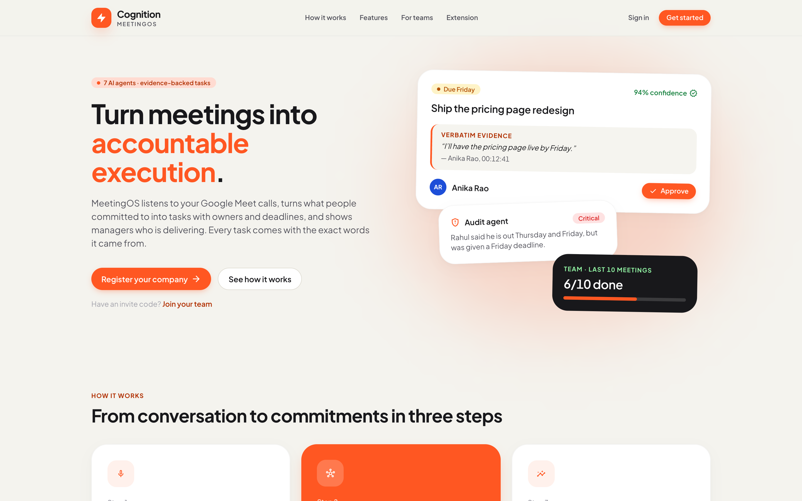
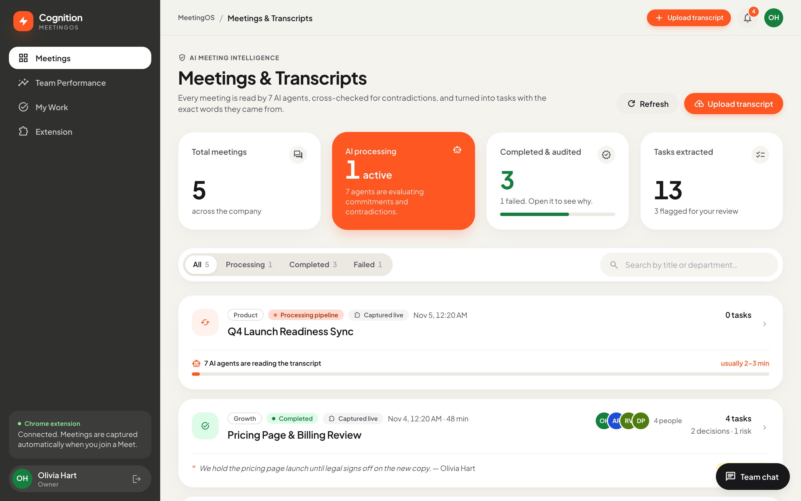
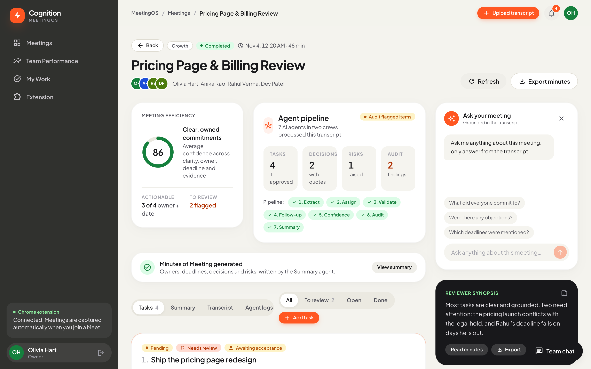
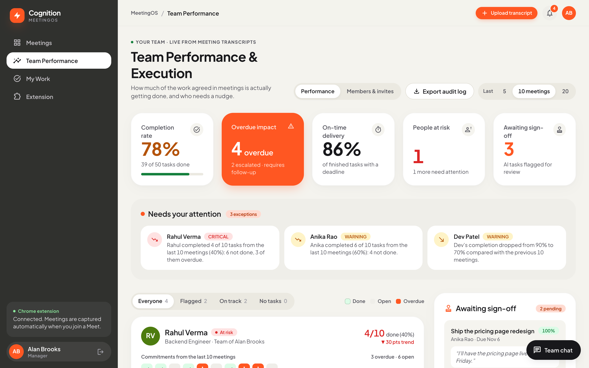
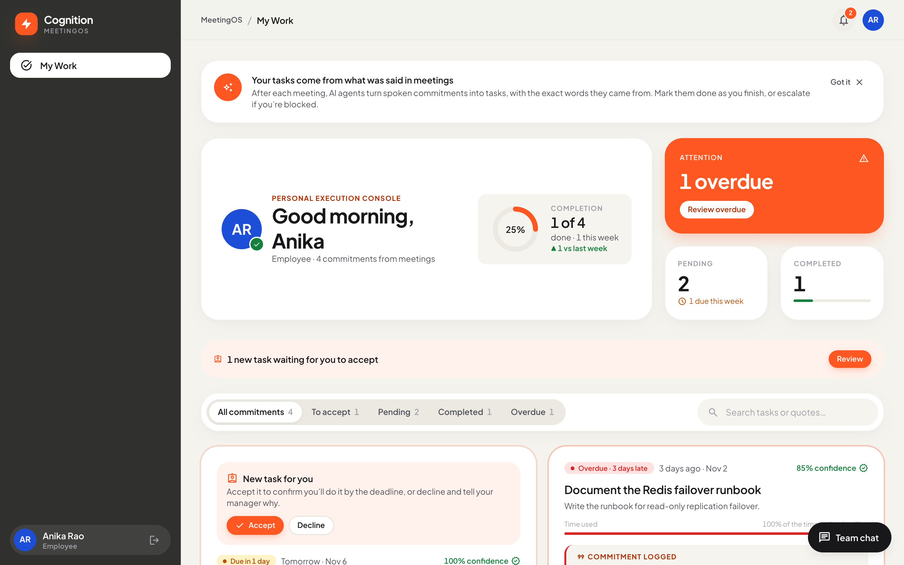
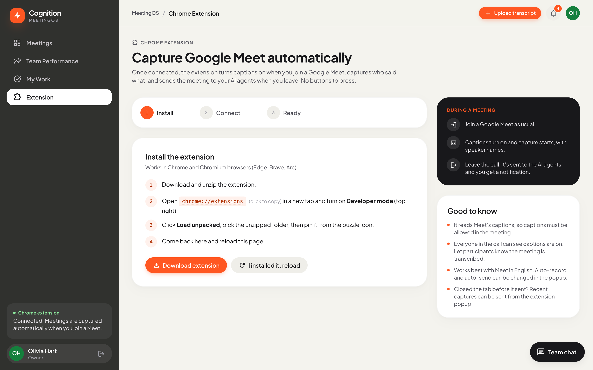

# Cognition MeetingOS

> An agentic AI system that turns meetings into accountable execution: grounded tasks, owners, deadlines, follow-ups and minutes, reviewed by a human before they reach the team.




Cognition MeetingOS takes a Google Meet transcript and runs it through a **CrewAI multi-agent pipeline** of 7 agents. Out come:

- **Tasks** with a resolved owner (a real team member), an absolute deadline, a confidence score and a follow-up plan
- **Decisions** and **risks**, kept separate from tasks
- **Minutes of Meeting** in five standard sections
- A **full audit trail** of every agent step and every human action

Every extracted item carries the **verbatim transcript quote** it came from, so nothing reaches employees that wasn't actually said.

> **Status:** not deployed yet. Run it locally with the steps in [Getting started](#getting-started); the [Deployment](#deployment) section describes the planned Vercel + Render + Firebase setup.

## Contents
[Architecture](#architecture) · [Agent pipeline](#the-agent-pipeline) · [Roles and security](#roles-and-security-model) · [Design](#design) · [Getting started](#getting-started) · [Deployment](#deployment) · [Screenshots](#screenshots) · [Roadmap](#roadmap)

## Why it's built this way

- **Agents judge, code decides.** Anything with a single right answer (dates, owner matching, confidence scores) is computed in Python and unit-tested. The LLM never changes a score.
- **Grounded or dropped.** Guardrails reject agent output whose quotes aren't in the transcript, and the agent retries.
- **Humans stay in the loop.** Doubtful tasks are flagged with a reason and wait for manager approval.
- **Secure by hierarchy.** Roles come only from invite codes and are written only by the backend; Firestore rules block clients from granting themselves access.

## Architecture

```
Google Meet ──► Chrome extension ──► FastAPI ──► Crew 1 (4 agents) ──► Python assembly ──► Crew 2 (3 agents) ──► Firestore ──► React dashboards
  (captions)     (or paste/upload)    (auth +       extract, assign,     dates, owners,       explain, audit,        idempotent      PM · Manager · Employee
                                       roles)       verify, plan         scores               summarize              writes
```

| Layer | Tech |
|---|---|
| AI pipeline | CrewAI 1.x, Gemini (`gemini-3.6-flash` by default; any LiteLLM model via `LLM_MODEL`) |
| Backend | Python 3.12, FastAPI, Firebase Admin SDK, slowapi, dateparser |
| Data & auth | Cloud Firestore, Firebase Authentication (email + Google) |
| Frontend | React 19, Vite, Tailwind CSS 4 |
| Capture | Chrome extension (Manifest V3): Google Meet captions, plus optional call audio transcribed by Whisper (Groq) |

## The agent pipeline

Agents do the work that needs judgement. Anything with a single correct answer is computed in Python, where it's testable.

Two crews with a Python step between them. Crew 2 works on the *assembled* result, so it sees real owners, resolved dates and scores.

| Step | Owner | What it does |
|---|---|---|
| 1. Extract | **Extraction agent** | Pulls out every task, decision and risk, each with a verbatim `evidence_quote`. A **guardrail** rejects the output and makes the agent retry when quotes don't appear in the transcript. |
| 2. Assign | **Assignment agent** | Picks an owner from the company's real team roster and the meeting participants. |
| 3. Verify | **Validation agent** | Re-reads the transcript, marks ungrounded items, and flags vague or doubtful ones for the PM with a reason. |
| 4. Plan | **Follow-up agent** | Chooses when to check in on each task and who to escalate to. |
| 5. Resolve | Python | Resolves spoken deadlines ("by Friday") against the meeting date, matches owners to user IDs, and scores confidence with a transparent 4 × 25 rubric (clarity, owner, deadline, evidence). An item is dropped only if the verifier agent *and* a deterministic quote check both say it's made up. |
| 6. Explain | **Confidence agent** | The number is computed by code and never changed by the LLM. The agent explains, per task, why it scored that and what would raise it ("No deadline given → ask Rahul"). |
| 7. Audit | **Audit agent** | Cross-checks the final result against the transcript for contradictions, duplicates, decisions nobody owns, deadline clashes and someone assigned work they said they couldn't do. Cheap automated checks (past deadlines, duplicate titles, overloaded owners) run first and feed into it. Warnings send the task back to the PM with the reason. |
| 8. Summarize | **Summary agent** | Writes the Minutes of Meeting from the final data. |
| 9. Persist | Python | Batch-writes tasks with stable IDs, so re-runs never duplicate them. Logs each agent step to the audit trail. Marks the meeting `failed` (never a silent "completed") if Crew 1 fails; if Crew 2 fails part-way (for example an API quota error), the tasks are still saved and a warning is logged. |

Agents exchange **Pydantic structured outputs** (`backend/crew/schemas.py`). Later agents annotate items by index instead of rewriting the list, so no agent can silently drop fields another agent produced.

## Roles and security model

**Company → Managers → their team.** A company is registered by an **Owner**, who invites **Managers**; each manager invites their own **team** (employees).

- **Roles are never self-assigned.** Registering a company makes you its Owner. Everyone else joins with an **invite code** that fixes their role: a manager invite from the owner, or a team invite from a manager (the joiner lands in that manager's team). Codes expire after 7 days.
- Company membership, roles and teams are written **only by the backend** (Admin SDK). [`firestore.rules`](firestore.rules) blocks clients from writing `role`, `companyId` or `managerId`. Owners can never be removed or demoted.
- Access follows the hierarchy ([`backend/access.py`](backend/access.py)). Meetings and tasks belong to a team: managers fully see and approve their own team's work, owners see everything.
- **Employees see only meetings they were part of**, and only the minutes, decisions, risks and their own tasks. Never the transcript, the AI audit trail or colleagues' tasks.

| Action | Owner | Manager | Employee |
|---|:-:|:-:|:-:|
| Invite managers / change roles / move people between teams | ✓ | | |
| Invite people into their own team | ✓ | ✓ | |
| Upload meetings | ✓ (pick a team) | ✓ (own team) | |
| Approve, reject or edit AI tasks | all | own team | |
| See transcript, audit trail, ask the meeting | all | own team | |
| See tasks | all | own team | own only |
| Update a task's status | all | own team | own only |
| See minutes, decisions, risks | all | own team | meetings they attended |

New owners and managers get a getting-started checklist, and employees a short welcome.

### Task workflow

AI proposes → manager approves, edits, reassigns or rejects → **the assignee accepts or declines** (a decline needs a reason and goes back to the manager) → the assignee reports progress (0–100% with a note) → done. Managers can also add tasks by hand to a processed meeting. Every task shows a clear deadline with a countdown, the assignee's job title, and its progress history. Risks carry a severity (high / medium / low) and a suggested mitigation; meetings show their length and participants.

A notifications bell surfaces tasks waiting for acceptance, overdue or due-soon work, declines, approvals and processed meetings.

### Team performance dashboard

Managers (and owners, company-wide) get a **Team** page answering *"of the work given in the last 10 meetings, how much is actually done?"*. Each person shows done vs assigned, a square per task (done / open / overdue), on-time rate and trend. Early-warning alerts surface whoever is slipping, for example *"Anika completed 6 of 10 tasks from the last 10 meetings (60%): 4 not done."*, plus overdue piles, declines vs the previous period and tasks nobody has touched in two weeks. The window can be switched between 5, 10 and 20 meetings. A weekly velocity chart compares tasks created vs completed, each person shows their oldest overdue task, and the whole task history can be exported as a CSV audit log.

## Design

A light "Warm Bento" design system (sand canvas, white rounded cards, coral accents, dark sidebar) generated with Google Stitch and implemented in Tailwind v4 tokens (`frontend/src/index.css`) with shared primitives in `frontend/src/components/ui.jsx`. Includes breadcrumbs, back navigation, per-page tab titles, a 404 page, an error boundary and keyboard-friendly menus.

To preview every screen with sample data and no backend, run the dev server and in the browser console set `localStorage.setItem('meetingos_mock', 'pm')` (or `'manager'`, `'employee'`), then reload. Remove the key to exit. This mode is dev-only and never part of production builds.

## Getting started

### Prerequisites
- Python 3.12, Node 20+
- A Firebase project with Authentication (Email/Password + Google) and Firestore enabled
- A [Gemini API key](https://aistudio.google.com/apikey)

### Backend
```bash
cd backend
python -m venv venv && source venv/bin/activate    # Windows: venv\Scripts\activate
pip install -r requirements-dev.txt
cp .env.example .env                                 # fill in GEMINI_API_KEY
# Firebase console → Project settings → Service accounts → Generate new private key,
# save it as backend/firebase-service-account.json (gitignored)
uvicorn main:app --reload --port 8010                # 8010, so it doesn't clash with other local APIs on 8000–8004
```

> **Free-tier note:** Gemini's free tier allows about 20 requests per day for `gemini-3.6-flash`, and one meeting uses about 6–10. For a demo on the free tier, set `LLM_MODEL=gemini/gemini-3.1-flash-lite`, or add billing to your key.

### Frontend
```bash
cd frontend
npm install
cp .env.example .env    # Firebase web config + VITE_API_URL=http://localhost:8010
npm run dev             # → http://localhost:5174
```

### Firestore rules
```bash
firebase deploy --only firestore:rules
```

### Chrome extension
1. Open `chrome://extensions/`, enable **Developer mode**, click **Load unpacked** and select the `extension/` folder (or download the zip from the landing page).
2. Click the extension and press **Connect account**. The web app's *Extension* page gives it its own revocable key (owners and managers only).
3. Join a Google Meet. The extension turns on captions, captures them **with speaker names** (block-based capture adapted from [TranscripTonic](https://github.com/vivek-nexus/transcriptonic), MIT: each speaker turn is kept at its final, corrected text), shows a small *Recording* badge in the call, and sends the meeting to the AI agents when you leave, with a notification linking to it.

Settings in the popup: auto-record, auto-captions, auto-send. A closed tab never loses a capture: recent captures can be sent from the popup, and transcripts can also be pasted. After changing extension files, run `npm run zip:extension` in `frontend/` to refresh the download. To use a production web app domain, add it to the `bridge.js` match list in `extension/manifest.json`.

**More accurate transcripts (free):** Meet's live captions often mishear names and jargon. While in a call, open the extension and click **Use call audio for accuracy**. The extension then records the other people's audio, and the backend transcribes it with [Whisper on Groq](https://console.groq.com/keys) (free tier; set `GROQ_API_KEY` in `backend/.env`) using your team's names as spelling hints. Captions are still used to know who spoke, and for your own lines. If audio transcription is unavailable, the captions are used, so you never get less than before.

Caption and audio-merge logic is unit-tested: `cd extension && node --test`.

### Tests
```bash
cd backend && python -m pytest -q      # 104 tests
cd extension && node --test            # 25 tests
```
The tests cover the grounding check and guardrail, deadline resolution, owner matching, the confidence rubric, result assembly, the audit checks, the two-crew flow (with the LLM stubbed, including a mid-run failure), the whole hierarchy (invites, joining, teams, meeting/task scoping, employee redaction) and the task workflow (accept/decline, progress, reassign, manual tasks, notifications, CSV export) against an in-memory Firestore fake. They need no Firebase credentials or LLM.

## Deployment

| Piece | Where | Config |
|---|---|---|
| Frontend | Vercel | `frontend/vercel.json` (SPA rewrite); set `VITE_API_URL` and the `VITE_FIREBASE_*` variables |
| Backend | Render | `render.yaml`; set `GEMINI_API_KEY`, `FIREBASE_SERVICE_ACCOUNT_KEY`, `ALLOWED_ORIGINS` (your Vercel domain), optional `GROQ_API_KEY` |
| Auth + database | Firebase | Deploy `firestore.rules`; add the Vercel domain under Authentication → Authorized domains |

After deploying, add the web app's domain to the `bridge.js` match list in `extension/manifest.json` and rebuild the extension zip (`npm run zip:extension` in `frontend/`). Meeting processing runs in-process, so use a backend plan that doesn't sleep. See the Roadmap for the planned job queue.

## Screenshots

Every screen below runs on sample data in dev preview mode (see [Design](#design)).

| Meetings dashboard | Meeting detail |
|---|---|
|  |  |

| Team performance | My work (employee) |
|---|---|
|  |  |



## Roadmap

**Agentic pipeline v2**
- Move to a CrewAI **Flow** with persisted state and live per-step progress.
- Human-in-the-loop routing: auto-approve confident tasks, send the rest to the PM.
- Give the assignment agent tools over the team directory and existing open tasks, so it links follow-ups across meetings instead of duplicating them.
- A scheduled **follow-up agent** that nudges owners and escalates in the team chat.
- An eval suite with precision and recall on hand-labelled transcripts.

**Future capture options** (researched, not built)
- **Meeting bot:** a bot joins the call so nobody needs the extension. [Vexa](https://github.com/Vexa-ai/vexa) is open source and free to self-host with Docker, using Groq's free Whisper tier for speech-to-text; Recall.ai and Vexa's hosted service are paid. Alternatively, a home-grown Playwright bot that reads Meet's captions. Both need an always-on machine.
- **Google Meet REST API:** import the official transcript after the meeting. Requires paid Google Workspace plans with transcripts enabled, and Google's app verification for public use.

**Production**
- A job queue instead of in-process background tasks.
- Firebase custom claims for roles.
- Push tasks to Slack, Linear and Jira.
- Tracing and cost tracking, and CI running tests and evals.

## Docs
- [Web app design brief](docs/WEB_APP_DESIGN_BRIEF.md) · [Project context](PROJECT_CONTEXT.md) (architecture, data model and gotchas)
